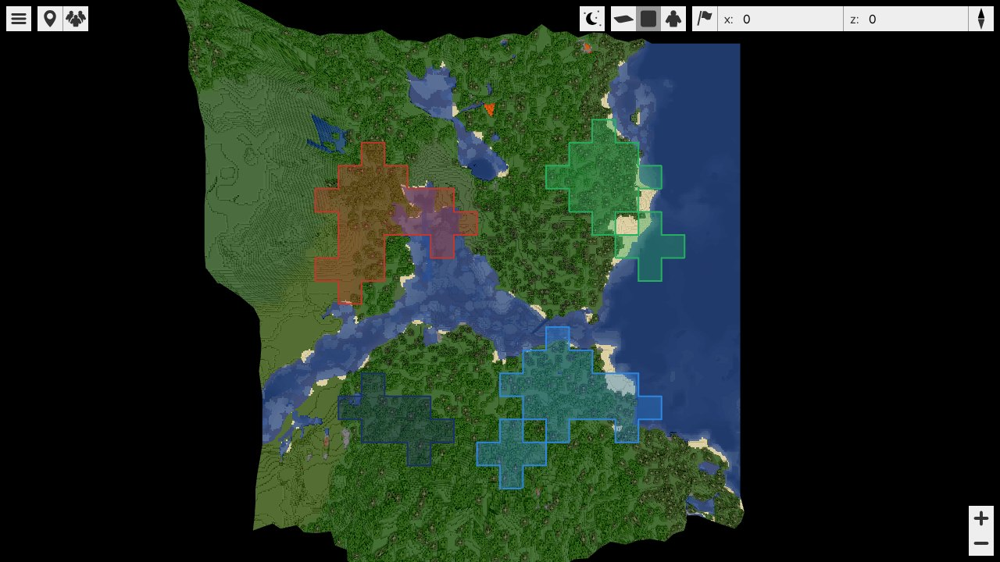
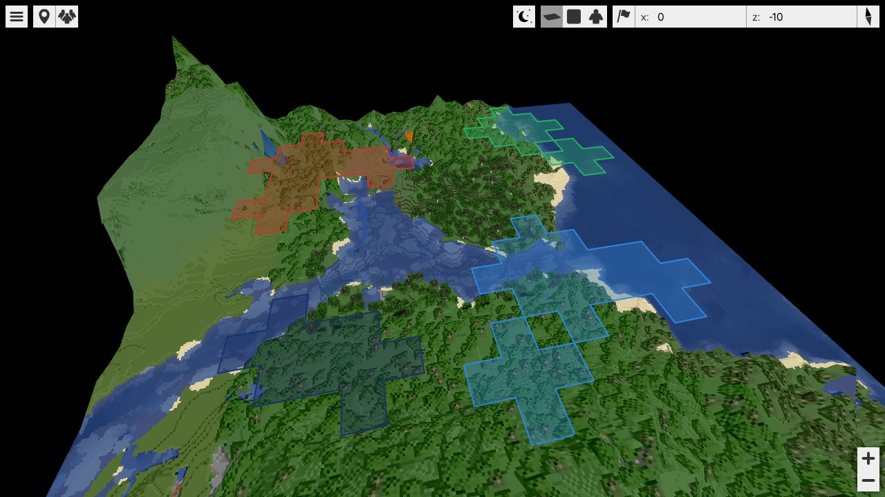
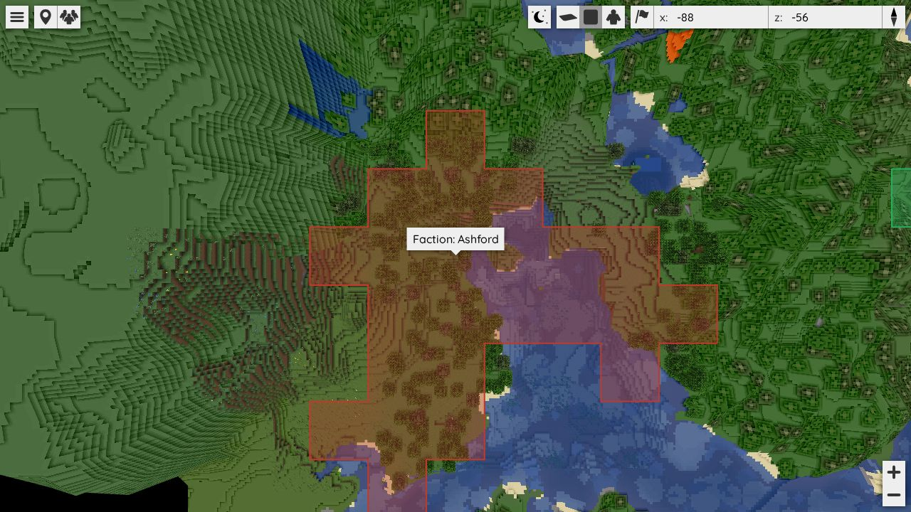
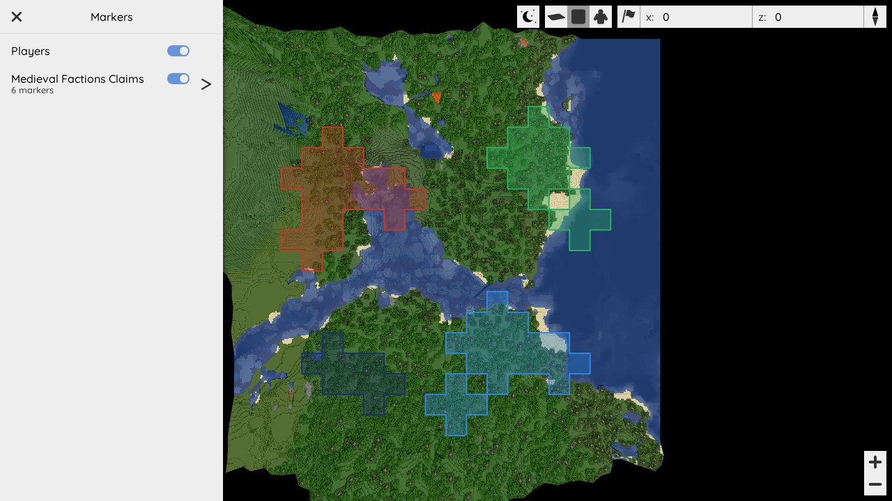
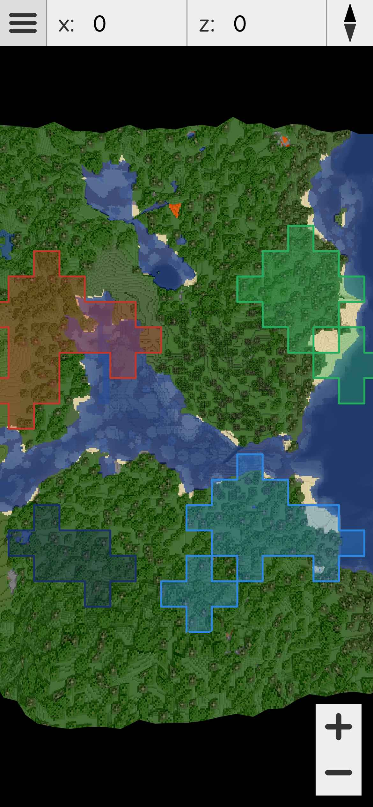
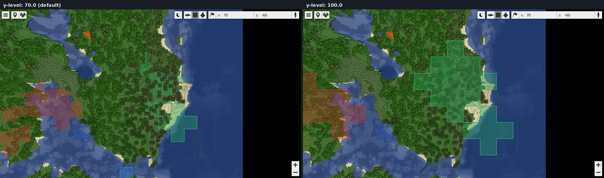

# Bluemap_MedievalFactions

## Description

Bluemap_MedievalFactions is a Minecraft plugin that integrates [Medieval Factions](https://github.com/Dans-Plugins/Medieval-Factions) with [BlueMap](https://bluemap.bluecolored.de/), rendering faction land claims as coloured shape overlays on your BlueMap web map. Claimed chunks are merged into contiguous polygons per faction, and redrawn automatically whenever a faction claims or unclaims a chunk or is disbanded.



*Four demo factions' claims on a BlueMap web map. Each faction's claimed chunks are merged into outlined polygons in its own colour (its Medieval Factions colour flag, or one the plugin derives when that flag is unset).*

## Supported Minecraft Versions
This plugin is supported on the Minecraft versions listed in [`minecraft-versions.json`](minecraft-versions.json): currently **26.2** and **26.3** (Spigot and its forks). Every stable release is booted on a real server of each of these versions, beside the current stable releases of Medieval Factions and BlueMap, before it is published, and every build checks that the plugin only uses Bukkit API that exists on all of them.

Earlier versions are not listed because of BlueMap, not this plugin: current BlueMap releases are built for Java 25, which only the 26.x servers run, so a 1.21.x server cannot load the BlueMap this plugin is verified against. The plugin itself targets Java 17 and `api-version: 1.21`, and its Bukkit API use also resolves on 1.21.11, so it is expected to work there beside an older BlueMap release that server can run, but that combination is not tested. To support another version, add it to the file: both checks pick it up.

## Screenshots

| | |
|---|---|
|  |  |
| The same claims in BlueMap's 3D perspective view. | Clicking a claim shows its label, set by `bluemap.label-format` (default `Faction: %faction%`). |
|  |  |
| The **Medieval Factions Claims** marker set in BlueMap's marker list, where viewers can toggle it. | The overlay in a phone-width browser. |



*`bluemap.y-level` at the default `70.0` (left) and at `100.0` (right). Where terrain or trees rise above the overlay's level, the claim is hidden under them; see [CONFIG.md](CONFIG.md#bluemapy-level).*

These screenshots were captured from a local test server (Spigot 1.21.1, Medieval Factions 11.1.1, BlueMap 5.15 and a build of this plugin from `master`), with four demo factions (Ashford, Briarwood, Coldharbor, Dunmere) created by test bots. Ashford, Briarwood and Coldharbor had their colour flag set with `/f flag set color`; Dunmere's was left at Medieval Factions' default, and the plugin's default `auto` colour mode picked its colour. Every shot except the left half of the y-level comparison uses `y-level: 100.0`. Note that 1.21.1 is not one of the versions in [Supported Minecraft Versions](#supported-minecraft-versions): it was used because the capture machine had no Java 25 for a 26.x server.

**Regenerating screenshots:** with the BlueMap web server running, `darkroom shoot docs/screenshots/media.json --var base=http://127.0.0.1:8100/` (using [darkroom](https://github.com/Preponderous-Software/darkroom)) reshoots them from the shot list; the y-level pair takes `--only y-level --tag before` at `y-level: 70.0`, `--tag after` at `100.0`, then `--only y-level-compare`.

## Installation

### First Time Installation

1. Download the plugin jar from the [Releases](https://github.com/Dans-Plugins/Bluemap_MedievalFactions/releases) page.
2. Place the jar in the `plugins` folder of your server.
3. Restart your server.

### Required Companion Plugins

This plugin requires the following plugins to be installed and enabled before it will load:

- [Medieval Factions](https://github.com/Dans-Plugins/Medieval-Factions) – the factions system whose claims are rendered.
- [BlueMap](https://www.spigotmc.org/resources/bluemap.83557/) – the web-map renderer that displays the overlays.

**Compatibility:** Bluemap_MedievalFactions v1.0 was enabled against [Medieval Factions](https://github.com/Dans-Plugins/Medieval-Factions) 7.0.0 by the [dependents gate](https://github.com/Dans-Plugins/release-gates/actions/runs/36957984824) before Medieval Factions 7.0.0 was published.

**Other Medieval Factions expansions:** [Currencies](https://github.com/Dans-Plugins/Currencies) (faction currencies), [Fiefs](https://github.com/Dans-Plugins/Fiefs) (sub-factions), [Democracy](https://github.com/Dans-Plugins/Democracy) (elections). All of them are listed in the [Medieval Factions README](https://github.com/Dans-Plugins/Medieval-Factions#expansions).

## Usage

### Documentation

- [User Guide](USER_GUIDE.md) – Getting started and common scenarios
- [Commands Reference](COMMANDS.md) – Complete list of all commands
- [Configuration Guide](CONFIG.md) – Detailed configuration options

### Wiki & Additional Resources

- [Wiki](https://github.com/Dans-Plugins/Bluemap_MedievalFactions/wiki)

## Support

You can find the support Discord server [here](https://discord.gg/xXtuAQ2).

### Experiencing a bug?

Please fill out a bug report [here](https://github.com/Dans-Plugins/Bluemap_MedievalFactions/issues/new).

- [Known Bugs](https://github.com/Dans-Plugins/Bluemap_MedievalFactions/issues?q=is%3Aissue+is%3Aopen+label%3Abug)

## Contributing

- [CONTRIBUTING.md](CONTRIBUTING.md)
- [Notes for Developers](https://github.com/Dans-Plugins/Bluemap_MedievalFactions/wiki)

## Testing

### Unit Tests

```
mvn clean test
```

Tests live in `src/test/java/` and run on JUnit 5 via Maven Surefire. Check the
Surefire summary for the number of tests actually executed — a `BUILD SUCCESS` with
`Tests run: 0` verifies nothing.

Coverage is limited to the logic that does not need a running server: claim-chunk
geometry (`ClaimGeometry`) and colour resolution (`FactionColors`). Everything that
touches the Bukkit or BlueMap APIs is still verified by building the plugin and
running it on a Paper server with Medieval Factions and BlueMap installed.

Running the tests needs the same Medieval Factions jar as the build — see
[Build Prerequisite](#build-prerequisite) below.

## Development

### Build Prerequisite

Medieval Factions is declared in `pom.xml` as a `system`-scope dependency resolved from
`libs/medieval-factions-6.0.0-live-all.jar`. That directory is gitignored and the jar is not
distributed with this repository, so it must be supplied before any Maven goal will run.
See [CONTRIBUTING.md](CONTRIBUTING.md#build-prerequisite) for the steps.

### Building the Plugin

```
mvn clean package
```

Requires **JDK 21 or newer** — `bluemap-api` and `paper-api` ship Java 21 class files, so
a Java 17 compiler fails with `bad class file` even though the artifact targets Java 17.

The compiled jar will be placed in the `target/` directory.

## Authors and Acknowledgement

### Developers

| Name | Main Contributions |
|------|--------------------|
| Kilz | Original author and primary developer |

## License

This project is licensed under the [GNU General Public License v3.0](LICENSE) (GPL-3.0).

You are free to use, modify, and distribute this software, provided that:

- Source code is made available under the same license when distributed.
- Changes are documented and attributed.
- No additional restrictions are applied.

See the [LICENSE](LICENSE) file for the full text of the GPL-3.0 license.

## Project Status

This project is in active development.

### Changelog

See [CHANGELOG.md](CHANGELOG.md) for a release-by-release summary of changes.
