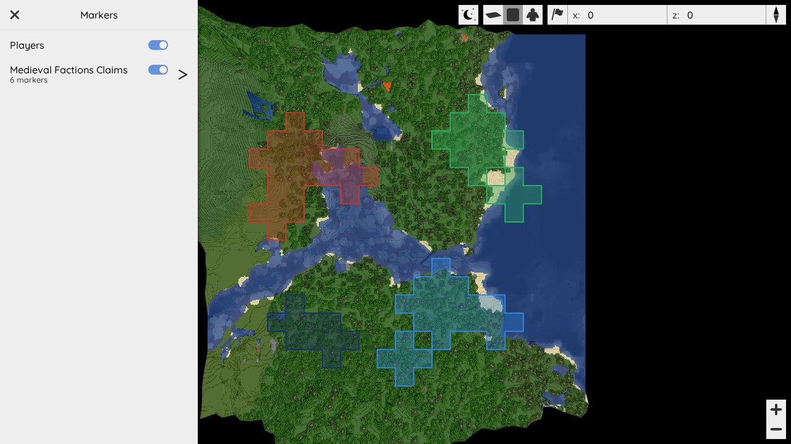
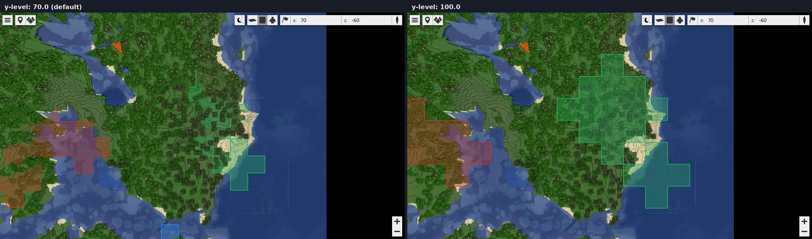
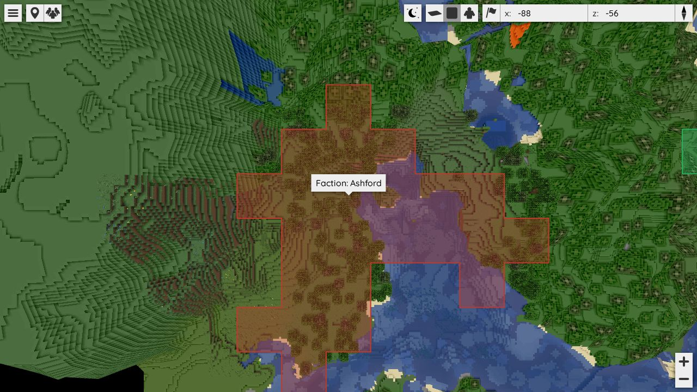

# User Guide

## Prerequisites

Before using Bluemap_MedievalFactions, ensure the following plugins are installed and running on your server:

- **Medieval Factions** – manages factions and land claims.
- **BlueMap** – renders the interactive web map.

Both plugins must be enabled before Bluemap_MedievalFactions loads. The plugin declares them as hard dependencies in `plugin.yml` and will disable itself if either is missing.

## First Steps

After placing the jar in your `plugins/` folder and restarting the server:

1. Open `plugins/MF_Bluemap/config.yml` to review the default settings.
2. Visit your BlueMap web interface (default: `http://<your-server-ip>:8100`).
3. You should see a **Medieval Factions Claims** marker layer available in the layer controls.

   

4. Claimed chunks will appear as coloured polygons on the map. Chunks belonging to the same faction that share an edge are automatically merged into a single shape; chunks that touch only at a corner are drawn as separate shapes meeting at a point.

## Common Scenarios

### Viewing Faction Claims

Once the plugin is running, no action is needed. Claims are drawn automatically once BlueMap has started, and a faction's territory is redrawn whenever it claims or unclaims a chunk or is disbanded.

A few things to expect:

- **Changes appear after about 1.5 seconds.** Redraws are debounced, so a burst of claims by one faction produces a single redraw once the claiming stops.
- **The startup sync is gradual.** Factions are drawn two per second, so on a server with many factions the map takes a while to fill in after a restart or a `/bluemap reload`.
- **Renames and colour changes wait for the next redraw.** The plugin does not listen for a faction being renamed or changing its colour flag, so the old label and colour stay on the map until that faction next claims or unclaims a chunk, the server restarts, or `/bluemap reload` is run. Because `factions:` overrides are matched by name, a renamed faction also loses its override at that redraw until the entry is renamed to match.

### Customising Faction Colours

By default each faction is drawn in its own colour flag from Medieval Factions, so the web map matches the colour players already see in chat and on territory titles. A faction whose flag is unset — or is still the literal `random` placeholder — falls back to a colour derived from its internal ID, which is stable across restarts. To override the colour for a specific faction, add an entry under `factions:` in `config.yml`:

```yaml
factions:
  MyFaction:
    fillColor: "#FF0000"
    fillOpacity: 0.35
    lineColor: "#FF0000"
    lineOpacity: 1.0
```

To give every faction without such an override one shared colour instead — a plain
"claimed land" overlay rather than a per-faction one — set `default-color.mode` to
`fixed`:

```yaml
default-color:
  mode: fixed
  fill-color: "#AAAAAA"
  line-color: "#0055FF"
```

Restart the server or run BlueMap's `/bluemap reload` for changes to take effect. The
plugin registers no commands of its own, but it re-reads `config.yml` every time BlueMap
starts, including after a `/bluemap reload`, and then redraws every faction.

### Changing the Overlay Y-Level

The Y-level at which overlays are rendered can be adjusted in `config.yml`:

```yaml
bluemap:
  y-level: 70.0
```

If trees or hills rise above that level, the overlay is drawn underneath them and only shows through the gaps. Raising it puts the whole claim on top:



*The same claim at `y-level: 70.0` (left) and `y-level: 100.0` (right).*

### Changing the Claim Label Format

The label shown on each claim marker can be customised with the `label-format` option. Use `%faction%` as a placeholder for the faction name:

```yaml
bluemap:
  label-format: "Faction: %faction%"
```

The label appears when a viewer clicks a claim on the map:



## Permissions

This plugin does not register any permission nodes. All functionality is server-side and automatic.
